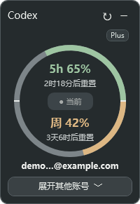
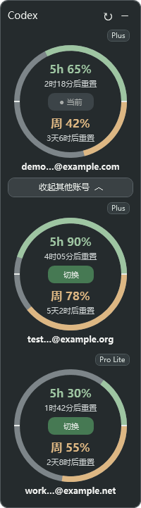

# Codex 用量悬浮窗

Windows 桌面上的轻量余量仪表盘：查看多个 Codex 账号的 **5 小时剩余额度、每周剩余额度和重置时间**，并通过本机 Codex Switcher 切换账号。

这是独立的第三方桌面工具，与 OpenAI 无隶属关系。当前为 **v0.1.0-beta.1**，面向已有 Codex Switcher 本机服务的 Windows 用户。

<p>
  
  
</p>

截图由实际 WPF 界面使用虚构的 example.com / example.org / example.net 账号生成；图中额度为示例。

## 功能

- 约 200 DIP 宽，默认折叠，拖动顶部移动；置顶显示且不主动抢走输入焦点。
- 上半圆为 5 小时剩余额度，下半圆为每周剩余额度，分别显示百分比与重置倒计时。
- 支持多个账号；当前账号置顶，其他账号可展开。每 60 秒在后台独立刷新。
- 未知额度显示 `—`；接口失败时保留旧数据并标注更新时间。
- 邮箱前缀缩略显示，悬停可见完整邮箱；套餐按服务返回值显示。
- 右上角 `−` 隐藏到托盘，双击托盘图标恢复；随 Codex 桌面窗口出现或隐藏。
- 点击其他账号的圆心切换；切换完成并核验活动账号后自动收起。

**点击“切换”会退出并重启 Codex 桌面应用，请先保存工作。** 单纯查看和刷新额度不会执行账号切换。

## 运行条件

- Windows 桌面环境，以及系统自带的 Windows PowerShell 5.1 / WPF。
- 已安装 Codex 桌面应用。Microsoft Store 版通过 Windows 包信息识别；其他安装方式需要设置 `CodexExecutable`。
- 已在 Codex Switcher 中完成账号登录。
- **支持 browser mode 的 Codex Switcher 本机服务**，默认地址 `http://127.0.0.1:3210`。仅安装图形界面不一定包含这个服务。

本工具使用 `/api/health` 和 `/api/invoke/{list_accounts,get_active_account_info,get_usage,switch_account}`。可参考 [支持 browser mode 的 Switcher 项目](https://github.com/xMags/Chatgpt-Codex-Switcher#browser-mode)；其源头项目为 [Lampese/codex-switcher](https://github.com/Lampese/codex-switcher)。请按依赖项目自己的说明安装或构建服务。第三方接口变化可能需要适配。

本项目不附带 Switcher 程序、账号、登录凭据，也不要求填写 OpenAI API Key。

## 安装

1. 下载仓库 ZIP 并解压到准备长期保留的目录，例如 `D:\Tools\codex-floating-widget`。
2. 确认 Switcher 的本机服务可用。如果它不在默认位置，先按下方说明填写配置。
3. 在解压目录打开 PowerShell，运行：

```powershell
powershell.exe -NoProfile -ExecutionPolicy Bypass -File .\Install.ps1 -DesktopShortcut -Start
```

安装脚本为当前用户创建独立的按需启动任务和桌面快捷方式，并启动悬浮窗。**默认不开启登录自启动。** 需要登录后自动运行时，改用：

```powershell
powershell.exe -NoProfile -ExecutionPolicy Bypass -File .\Install.ps1 -EnableStartup -DesktopShortcut -Start
```

独立任务用于让悬浮窗在 Codex 重启后恢复。安装不需要管理员权限；公司策略限制任务计划或脚本执行时，需要使用符合该电脑策略的方式安装。`-ExecutionPolicy Bypass` 只作用于本次进程，不会修改全局执行策略。

预览安装操作而不写入系统：

```powershell
powershell.exe -NoProfile -ExecutionPolicy Bypass -File .\Install.ps1 -DesktopShortcut -WhatIf
```

移动安装目录前，请先退出悬浮窗并从旧目录运行卸载脚本，再从新目录安装。不要仅移动目录后继续使用旧任务。

## 配置

默认读取 `%LOCALAPPDATA%\CodexFloatingWidget\config.json`。未创建配置时，使用内置默认值。

```powershell
$state = Join-Path $env:LOCALAPPDATA 'CodexFloatingWidget'
New-Item -ItemType Directory -Path $state -Force | Out-Null
Copy-Item .\config.example.json (Join-Path $state 'config.json')
notepad (Join-Path $state 'config.json')
```

复制示例前请确认没有需要保留的现有配置。

| 字段 | 默认行为 |
| --- | --- |
| `ApiPort` | 3210；只能连接本机回环地址 |
| `SwitcherExecutable` | 自动查找 Program Files 或 LocalAppData\Programs 下的 `Codex Switcher\codex-web.exe`；也可填绝对路径 |
| `CodexExecutable` | 留空时识别 Microsoft Store 版；其他版本填写桌面应用 `.exe` 的绝对路径，不要填写 Codex CLI |
| `CodexAppId` | 自动从已安装的 `OpenAI.Codex` 包解析；通常无需填写 |
| `StartupTaskName` | `Codex Floating Widget Public`；修改时只允许添加简单后缀 |

如果服务已经运行，仅需匹配端口；没有找到 `codex-web.exe` 也可以连接已启动的兼容服务。本工具不处理服务端另设的 HTTP 登录认证。

也可以使用指定的配置文件；安装和卸载时都传入同一个路径：

```powershell
powershell.exe -NoProfile -ExecutionPolicy Bypass -File .\Install.ps1 -ConfigPath D:\Tools\widget-config.json -DesktopShortcut -Start
```

运行数据与源码分开保存在 `%LOCALAPPDATA%\CodexFloatingWidget`：窗口位置 `widget-settings.json`、切换日志 `logs/`、临时完成结果 `switch-results/`。本版按单一 Windows 用户、单一运行实例设计。

## 卸载

先在托盘菜单选择“退出”，再从安装目录运行：

```powershell
powershell.exe -NoProfile -ExecutionPolicy Bypass -File .\Uninstall.ps1
```

它删除当前安装的任务和快捷方式，保留设置及项目文件。需要同时删除本工具的设置和日志时，加 `-RemoveSettings`。不会卸载 Codex 或 Codex Switcher。

## 常见问题

**没有显示窗口**：打开 Codex 桌面窗口；检查托盘图标，双击恢复。关闭 Codex 窗口时悬浮窗会隐藏。旧版自用悬浮窗与本版共用单实例锁，同时使用时请先退出另一份。

**“账号同步失败”或额度为 `—`**：确认 Switcher 已登录、服务启动且端口相同；第三方服务返回未知额度时本工具不会猜测。数据含义和可用性以依赖服务为准。

**找不到服务程序**：将 browser-mode 服务启动起来，或设置 `SwitcherExecutable`；常规 Switcher 安装包是否附带 `codex-web.exe` 取决于所用版本。

**切换失败**：确认已经运行安装脚本创建独立任务；检查本地日志和 Switcher 登录状态。非 Store 版需要填写正确的桌面应用路径。切换过程中请等待结果，避免手工同时更换认证文件。

**更新版本**：退出悬浮窗，将新版解压到原安装目录，再运行安装脚本。窗口设置保存在用户目录中。若旧版开启了登录自启动，更新时继续传入 `-EnableStartup`。

## 隐私与依赖边界

悬浮窗通过本机回环接口读取账号信息和用量，并在点击切换时委托 Switcher 换号。额度刷新与认证相关的网络访问由 Switcher 处理。本工具本身没有遥测、账号导出或凭据上传功能，也不直接编辑 Codex 的认证文件。

界面悬停会展示完整邮箱，分享屏幕时请留意。运行目录和日志不要上传到 Issue；请先移除账号标识、邮箱、路径及其他私人信息。发布截图全部使用虚构账号。不要把本机服务开放到公网。

## 开发与验证

```powershell
powershell.exe -NoProfile -ExecutionPolicy Bypass -File .\tests\Run-Tests.ps1
```

测试覆盖配置校验、桌面进程识别、圆弧比例、布局、异步刷新、窗口生命周期、账号切换控制与安装卸载。默认全部使用虚构数据或替代外部操作，不切换真实账号、不重启 Codex、不创建实际计划任务。界面测试会短暂显示示例窗口。

真实账号切换和新电脑全流程仍需使用者按环境验证；本次公开版没有为了测试而退出正在使用的 Codex。请参阅 [发布记录](CHANGELOG.md)。

## 许可证与致谢

本项目源码使用 [MIT License](LICENSE)。Codex、Codex Switcher 及其各分支分别遵循各自的许可与使用条件；本项目不重新分发它们的二进制或源码。感谢 Codex Switcher 提供本机账号和用量接口。
